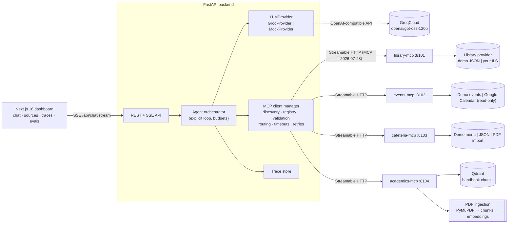
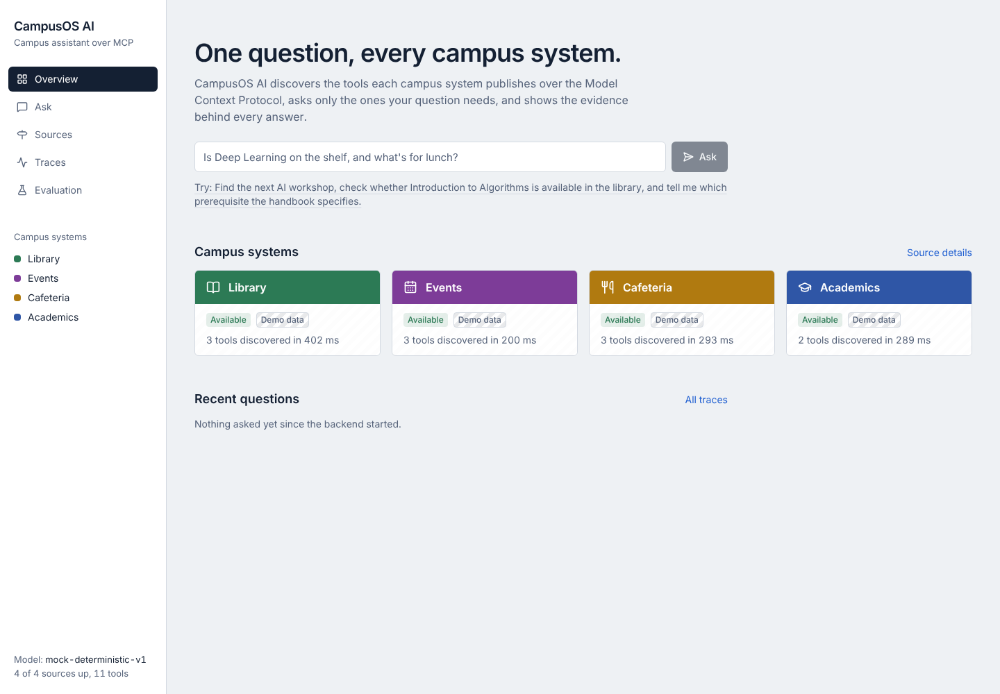
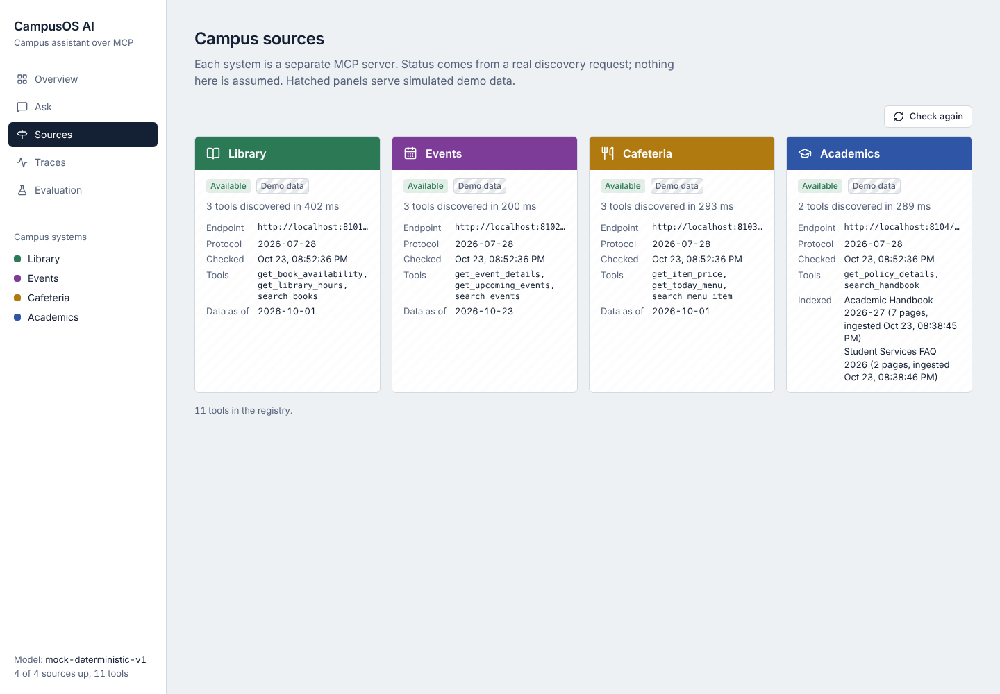
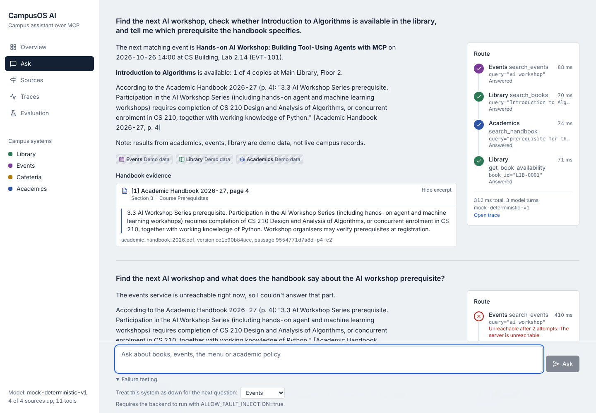
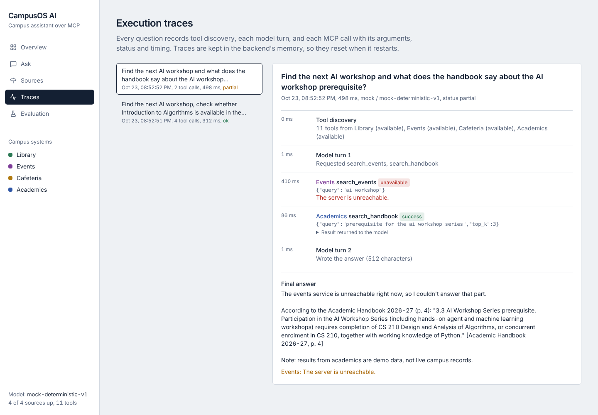

# CampusOS AI: unified campus intelligence over MCP

Ask one question and get one grounded answer drawn from several campus systems:

> *"Find the next AI workshop, check whether Introduction to Algorithms is available in the library, and tell me which prerequisite the handbook specifies."*

The backend discovers the tools that four independently running **Model Context Protocol (MCP)** servers publish (Library, Events, Cafeteria, Academics). It hands their schemas to **GPT-OSS-120B on GroqCloud** through native tool calling, executes only the calls the model picks, and returns an answer with handbook citations, source provenance (demo/imported/live) and a full execution trace.


## Why this design

Campus data is owned by different teams: the library system, the events calendar, catering, the registrar's handbooks. CampusOS does **not** copy those records into one central database. Each system sits behind its own MCP server that owns its integration logic, and the agent queries them at request time. The only derived store is a small Qdrant index of handbook PDFs, used for retrieval.

| Concern | How it's handled |
|---|---|
| Independent ownership | 4 separate processes/containers, each with its own `pyproject.toml`, lock file, Dockerfile and tests |
| No hardcoded tools | The backend learns every tool and input schema from `tools/list`; the orchestrator has no tool names in it |
| Grounding | Citations shown in the UI come from retrieval output, never from model text; page references in the answer are verified against retrieved passages |
| Failure isolation | Per-call timeouts, bounded retries, structured tool states, partial answers |
| Honesty about data | Every tool result carries `source.mode` (`demo`/`imported`/`live`) and freshness; the UI labels demo data with hatching |

## Architecture



More detail in [docs/architecture.md](docs/architecture.md).

### MCP client/server relationship

- **Servers** (`services/*_mcp`) use the official **MCP Python SDK v2.3.0** (`mcp.server.MCPServer`), exposing typed tools whose JSON Schemas come from the function signatures and Pydantic constraints. They run Streamable HTTP in stateless JSON mode with **DNS-rebinding protection** (explicit `Host` allowlist), plus a plain `/health` route that reports data mode and freshness.
- **The client manager** (`backend/app/mcp/manager.py`) uses the SDK's `mcp.Client`. On startup and on a TTL it calls `tools/list` on every allowlisted server, namespaces each tool as `<server>__<tool>` and stores it in the registry with its input schema. Each call opens a short-lived MCP session. With stateless servers that costs one extra round trip, but a restarted or crashed server recovers without any session repair.
- The registry is converted to the provider's tool format (`backend/app/llm/groq.py → to_openai_tools`). Adding a fifth MCP server means adding one entry to `backend/config/mcp_servers.json`; no orchestrator code changes.

### Tool discovery and orchestration

`backend/app/agent/orchestrator.py` runs one inspectable loop:

1. `ensure_fresh()` re-discovers stale or unavailable servers. Unavailable services are listed in the system prompt so the model can say so.
2. The query and the discovered tool schemas go to the LLM (`tool_choice="auto"`).
3. Each requested call is **parsed** (malformed JSON goes back to the model as `invalid_arguments`), checked against the **budget**, **validated** against the discovered JSON Schema with unknown keys rejected, and then **routed** to its owning server with a per-call timeout and one retry for transient failures.
4. Results go back to the model wrapped as `<tool_result untrusted="true">…</tool_result>`, compactly serialised and size-capped. Identical repeated calls within a run are served from a run cache.
5. The loop stops at a final answer, or at `MAX_AGENT_ITERATIONS`, after which one last call is made with tools disabled. Empty responses and Groq `tool_use_failed` errors get one corrective retry each.

Execution is **sequential by default**, because Groq documents `openai/gpt-oss-120b` as supporting tool use but not parallel tool calls; `parallel_tool_calls` is never sent. `TOOL_EXECUTION_MODE=concurrent` runs the independent read-only calls of a single model turn with `asyncio.gather`, which the mock provider exercises and a test verifies.

Every step (discovery, each model turn with token usage, each tool call with arguments, status, attempts and duration) is recorded in a trace at `/api/traces/{id}` and rendered on the Traces page.

### RAG and citation methodology

- **Ingestion** (`academics_mcp/ingest.py`): PyMuPDF extracts text **per page** with 1-based page numbers. Chunks are clause-aware (one numbered clause or Q&A pair each) and **never cross a page boundary**, so a citation always points to exactly one page. Each chunk carries the document title, file name, page, section heading, chunk id and document version (the sha256 of the file).
- **Idempotent re-ingestion**: unchanged files are skipped, so restarts don't duplicate chunks. Changed files have their old chunks deleted before re-insertion, and deleted files are pruned. Point ids are `uuid5(chunk_id)`.
- **Retrieval**: cosine search in Qdrant, then a minimum score **and** at least one shared content term. Below that, the tool returns `found=false` with an insufficient-evidence message instead of the least-bad passage.
- **Untrusted content**: instruction-like text in documents ("ignore previous instructions…") is redacted and flagged. A passage left with no content after redaction is withheld. The orchestrator also wraps all tool output as untrusted data. The demo FAQ deliberately contains such an injection.
- **Citations** in the UI come from the passages the tool returned. `verify_citations` flags any `[Title, p. N]` or `p. N` in the answer that no retrieved passage supports, and the UI shows a warning when that happens.
- **Freshness**: the index is a snapshot. Every academics result reports `ingested_at` and `document_version` per document. To refresh, replace the PDFs and restart the server (or run `python -m academics_mcp.ingest`).
- **Embeddings**: the default is a deterministic **hashing embedder** (offline, no model download). It is lexical, so paraphrases fail; eval case `rag-07` ("ChatGPT" vs "generative AI tools") fails for exactly this reason. Set `EMBEDDING_PROVIDER=fastembed` to use BAAI/bge-small-en-v1.5 (optional extra; downloads the model on first use; not exercised in this repo's tests).

## Repository layout

```
frontend/                 Next.js 16 (App Router) + React 19 + Tailwind v4 + shadcn-style components
backend/                  FastAPI app: api/, agent/ (orchestrator, prompts, citations, traces), llm/, mcp/
services/library_mcp/     Library MCP server (search_books, get_book_availability, get_library_hours)
services/events_mcp/      Events MCP server (search_events, get_upcoming_events, get_event_details)
services/cafeteria_mcp/   Cafeteria MCP server (get_today_menu, search_menu_item, get_item_price)
services/academics_mcp/   Academics MCP server (search_handbook, get_policy_details) + ingestion + demo PDFs
evals/                    51-case benchmark, runner, reports
tests/                    Cross-service integration tests (in-process and real HTTP processes)
infra/                    Docker Compose
docs/                     Architecture, API, evaluation, demo script, Google Calendar setup, screenshots
```

## Setup

**Prerequisites:** Python ≥ 3.11 (tested on 3.12 and 3.13), Node.js 22, npm. Docker is optional.

```bash
git clone <your-repo-url> campusos && cd campusos
cp .env.example .env             # works as-is in mock mode; add GROQ_API_KEY for the real model
make install                     # .venv with all packages from lock files + frontend deps
```

Without `make` (e.g. Windows PowerShell), the same steps:

```bash
python -m venv .venv && .venv/Scripts/activate      # macOS/Linux: source .venv/bin/activate
for s in library events cafeteria academics; do pip install -r services/${s}_mcp/requirements.lock -e "services/${s}_mcp[dev]"; done
pip install -r backend/requirements.lock -e "backend[dev]" ruff mypy pyyaml types-PyYAML
cd frontend && npm ci
```

### Run locally (four terminals, or `make servers` + `make backend` + `make frontend`)

```bash
MCP_PORT=8101 python -m library_mcp
MCP_PORT=8102 python -m events_mcp
MCP_PORT=8103 python -m cafeteria_mcp
MCP_PORT=8104 python -m academics_mcp        # ingests the demo PDFs on start (in-memory Qdrant by default)
cd backend && uvicorn app.main:app_factory --factory --port 8000
cd frontend && npm run dev                   # http://localhost:3000
```

API docs: http://localhost:8000/docs.

### Run with Docker Compose

```bash
docker compose -f infra/docker-compose.yml up --build
```

This starts Qdrant (`qdrant/qdrant:v1.19.2`), the four MCP servers, the backend (`:8000`) and the frontend (`:3000`). The backend waits for the servers' health checks. Set `PUBLIC_API_BASE_URL` if the browser reaches the API on a different URL; it is inlined into the frontend at build time.

> **Verification status:** `docker compose config` validates, but the images were **not built** in the development sandbox, which had no access to Docker Hub. CI builds them (`docker` job). Treat the first `up --build` as the real test.

## Configuration

All configuration comes from environment variables; see [`.env.example`](.env.example) for every variable with its default. The important ones:

| Variable | Default | Purpose |
|---|---|---|
| `LLM_PROVIDER` | `mock` | `groq` for GroqCloud; `mock` runs fully offline |
| `GROQ_API_KEY` | – | Required when `LLM_PROVIDER=groq`; read only by the backend, never sent to the browser or logged |
| `GROQ_MODEL` | `openai/gpt-oss-120b` | Model id |
| `GROQ_BASE_URL` | `https://api.groq.com/openai/v1` | Groq's OpenAI-compatible endpoint (the real OpenAI API is never called) |
| `GROQ_REASONING_EFFORT` / `GROQ_INCLUDE_REASONING` | `low` / `false` | GPT-OSS reasoning controls |
| `MCP_<ID>_URL` | from `backend/config/mcp_servers.json` | Override a server URL; empty means *not configured* |
| `MCP_ALLOWED_HOSTS` | localhost + compose names | Backend refuses to connect to any other host |
| `MAX_AGENT_ITERATIONS`, `MAX_TOOL_CALLS`, `TOOL_TIMEOUT_S`, `TOOL_MAX_RETRIES` | 5, 8, 8 s, 1 | Orchestration budgets |
| `TOOL_EXECUTION_MODE` | `sequential` | `concurrent` for parallel execution within one model turn |
| `ALLOW_FAULT_INJECTION` | `false` | Enables `simulate_failures` in chat requests (demo/testing) |
| `QDRANT_URL` / `QDRANT_PATH` | – / `:memory:` | Qdrant server, or embedded store |
| `EVENTS_PROVIDER`, `CAFETERIA_PROVIDER`, `LIBRARY_PROVIDER` | `demo` | Swap data providers per server |

**No silent model fallback:** if `LLM_PROVIDER=groq` has no key, `/api/health` reports `degraded` and chat requests fail with `llm_not_configured`. If Groq is rate-limited (HTTP 429), the OpenAI client retries up to `GROQ_MAX_RETRIES` times honouring `retry-after`, and then the answer fails with `llm_rate_limited`, keeping any partial tool results.

### Demo vs live integration modes

| Server | Demo (default) | Other providers |
|---|---|---|
| Library | `demo_books.json`: real book titles, **simulated** copies/availability | Implement `LibraryProvider` for your ILS (Koha/Alma/Folio) |
| Events | Fixture with dates **relative to today** | `EVENTS_PROVIDER=google`: read-only public Google Calendar ([setup](docs/google-calendar.md)) → `mode: live` |
| Cafeteria | Weekly menu fixture | `json` / `pdf` import → `mode: imported`, with `stale: true` outside its validity window. Never labelled live |
| Academics | Two fictional PDFs ("CampusOS Demo University") | Mount your PDFs and set `ACADEMICS_DATA_MODE=imported` |

All demo content is fictional and labelled as such in the data, the tool output, the answers and the UI.

## Example queries

- *Find the next AI workshop, check whether Introduction to Algorithms is available in the library, and tell me which prerequisite the handbook specifies.* → Events + Library (search, then availability) + Academics, cited p. 4
- *How much is the paneer butter masala, and what is the minimum attendance requirement?* → Cafeteria + Academics
- *What are the library hours on Sunday?* → Library only
- *What does the handbook say about parking permits?* → insufficient evidence, no citation
- *hello* / *What is the weather in Paris?* → no tool calls

## Testing and evaluation

```bash
make test          # every Python suite (each in its own pytest process) + frontend tests
make lint typecheck
make eval          # 51-case benchmark, deterministic (mock LLM, in-process MCP servers)
python -m evals.run_eval --transport http          # same benchmark against running MCP server processes
python -m evals.run_eval --provider groq --delay 3 # LIVE GroqCloud evaluation (uses your quota)
```

Tests executed for this version (all passing):

| Suite | Tests | Covers |
|---|---:|---|
| `services/library_mcp` | 19 | Search ranking and stopwords, availability, hours/closures, MCP schema validation, tool errors |
| `services/events_mcp` | 8 | Relative dates, word matching, date ranges, Google adapter with mocked HTTP (no key leakage) |
| `services/cafeteria_mcp` | 7 | Weekday menus, prices, suggestions, stale imported menus, PDF menu parsing |
| `services/academics_mcp` | 21 | Page boundaries, chunk metadata, idempotent/changed/removed re-ingestion, corrupt/blank PDFs, retrieval, insufficient evidence, injection redaction |
| `backend` | 70 | Allowlist config, log secret redaction, discovery/registry, schema validation, routing, retries/timeouts, Groq adapter (request shape, streaming tool-call assembly, 429/401/400 mapping, streaming fallback), orchestrator budgets and failures, concurrency, SSE protocol, error format, CORS, limits |
| `tests/` (integration) | 12 | All four servers in-process **and as separate OS processes over Streamable HTTP**, the multi-server flagship query, mid-request failure, down-at-discovery, timeout, injection, DNS-rebinding rejection |
| `frontend` (Vitest) | 9 | SSE parser, chat-state reducer, answer view (route, partial notice, demo labels, citations) |

Lint (`ruff`, `eslint`), strict type checking (`mypy --strict`, `tsc`) and `next build` pass. All Python suites were run on Python 3.13 (dev venv) and on Python 3.12 using only the lock files.

### Measured results (mock provider)

From `evals/reports/latest.md` (in-process) and `latest-http.md` (four MCP server processes over HTTP on one machine):

| Metric | In-process | Over HTTP |
|---|---|---|
| Cases passed | 50/51 | 50/51 |
| Tool-selection accuracy (exact server set) | 100% | 100% |
| Answer correctness | 98.0% | 98.0% |
| Citation correctness (17 cases) | 94.1% | 94.1% |
| Unnecessary tool-call rate | 0% | 0% |
| Recovery from simulated failures (4 cases) | 100% | 100% |
| End-to-end latency p50 / p95 | 23 ms / 275 ms | 321 ms / 666 ms |
| Tool-call duration p50 / p95 | 14 ms / 22 ms | 76 ms / 135 ms |

**Read these carefully.** With the mock provider, tool selection comes from a keyword router written alongside this dataset, so 100% tool-selection accuracy shows the *pipeline* works; it is **not** a measure of GPT-OSS-120B. The meaningful signals are retrieval and citation accuracy, failure recovery, and latency without LLM inference. The one failure, `rag-07`, is a real limitation of the lexical embedder. **No live Groq evaluation has been run yet**: the development sandbox could not reach `api.groq.com`. Run `python -m evals.run_eval --provider groq` to produce `latest-groq.md`. See [docs/evaluation.md](docs/evaluation.md).

## API

| Method | Path | Purpose |
|---|---|---|
| `POST` | `/api/chat` | Ask; returns `AgentResult` (answer, status, citations, sources, tool calls, warnings, citation check, usage) |
| `POST` | `/api/chat/stream` | Same, as Server-Sent Events: `start, discovery, llm_start, token, answer_reset, tool_start, tool_end, error, final, done` |
| `GET` | `/api/sources[?refresh=true]` | Per-server status (`available`/`unavailable`/`not_configured`), latency, protocol, tools, data mode |
| `GET` | `/api/tools` | Discovered tool registry with input schemas |
| `GET` | `/api/traces`, `/api/traces/{id}` | Recent traces / full trace |
| `GET` | `/api/evals/latest` | Latest evaluation report |
| `GET` | `/api/health`, `/api/health/live` | Health (LLM configured?, sources up) / liveness |

Errors always look like `{"error": {"code", "message", "request_id"}}`, never stack traces. Details in [docs/api.md](docs/api.md).

## Security considerations

Implemented and tested:
- Secrets come only from the environment. `.env`, credentials and tokens are git-ignored, and logs pass through a redaction filter.
- An MCP server **allowlist** (scheme and host) plus DNS-rebinding protection on every server.
- Tool arguments are validated against discovered schemas, with unknown keys rejected. All tools are read-only. Model output never chooses a URL or file path: the Google Calendar id and menu paths come from configuration.
- Per-call timeouts, bounded retries, iteration and tool-call budgets, a query-length limit (2,000 chars), a request-body limit (64 KB), and a concurrent-chat limit.
- Retrieved content is treated as untrusted (wrapping, redaction, withheld injection-only passages) and covered by eval cases `inj-01`/`inj-02`.
- CORS is restricted to configured origins. Fault injection is off by default.

**Not implemented:** user authentication/authorisation, rate limiting per user, persistent trace storage, TLS termination. Don't expose this deployment publicly as-is.

## Known limitations

- The live Groq path is unit-tested against mocked HTTP only. Whether Groq accepts **streaming combined with tools** for GPT-OSS is undocumented, so the adapter falls back to non-streaming automatically if a streamed request is rejected. Verify with a real key.
- Groq's free tier for `openai/gpt-oss-120b` lists **8K tokens/minute**. A multi-server query with 11 tool schemas can use several thousand tokens, so expect 429s on the free tier. Schemas and results are compacted to reduce this.
- The hashing embedder is lexical (see `rag-07`). FastEmbed is wired in but not exercised in tests.
- Traces live in memory (optional JSONL via `TRACE_LOG_PATH`), and the registry is per-process.
- Docker images were not built in the sandbox (see above).

## Deployment

`infra/docker-compose.yml` is the container deployment. For a single VM: install Docker, copy `.env`, run `docker compose -f infra/docker-compose.yml up -d --build`, and put a TLS reverse proxy (Caddy/nginx) in front of ports 3000 and 8000. Set `CORS_ORIGINS` and `PUBLIC_API_BASE_URL` to your public URLs. Every service is a stateless container except Qdrant (a volume), so each can also run separately on any container platform, with the backend's `MCP_<ID>_URL` pointing at it. No hosted deployment has been made or verified.

## Screenshots

| Overview | Source status |
|---|---|
|  |  |
| **Partial answer (Events down)** | **Execution trace** |
|  |  |

Evaluation page: [docs/screenshots/evals.png](docs/screenshots/evals.png). A five-step walkthrough is in [docs/demo-script.md](docs/demo-script.md).
