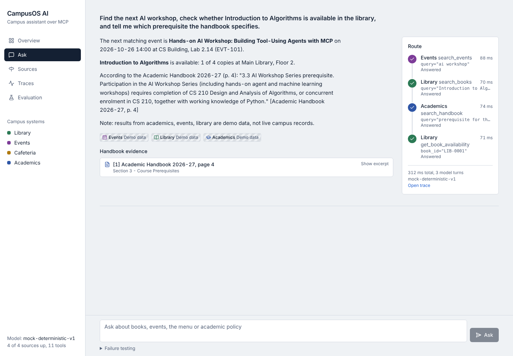
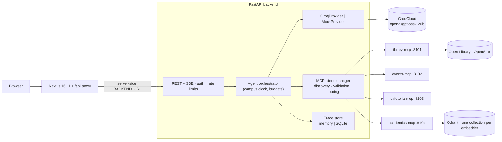

# CampusOrchestrator: an IIT Roorkee campus assistant over MCP

Ask one question and get one source-grounded answer drawn from several campus systems:

> *"What events are happening today, what is the attendance policy, and are there free physics textbooks?"*

The backend discovers the tools that four independently running **Model Context Protocol (MCP)** servers
publish (Library, Events, Cafeteria, Academics), hands their schemas to **GPT-OSS-120B on GroqCloud**
through native tool calling, executes only the calls the model picks, and answers with citations to
**official IIT Roorkee documents**, per-source provenance (demo / imported / live, checked-at time,
staleness) and a full execution trace.



_Screenshots in `docs/screenshots/` predate this upgrade (old name, fictional handbook) and have not been retaken._

## What is real and what is demo

| Service | Real data | Synthetic (labelled `demo`) |
|---|---|---|
| Academics | 17 official IIT Roorkee PDFs (UG Ordinances 2025, Ph.D. Regulations 2026, academic calendars, Senate notifications) from iitr.ac.in, with official URLs, issue dates, supersession and applicability; 2 scanned PDFs are reported as not indexed | – |
| Events | 83 dates transcribed from the official Autumn 2026-27 and Spring 2025-26 calendars (document + page on each) | 39 club/career/sports events, dates relative to today |
| Library | Bibliographic metadata of 138 titles verified against Open Library; live public discovery via Open Library and OpenStax (Google Books opt-in) | Copies, availability, shelves, due dates, opening hours |
| Cafeteria | – (mess.iitr.ac.in was not reachable) | Four-week menu rotation for three "(demo)" locations |

Every tool result carries `source.mode`, `retrieved_at` (when we queried) separately from `data_as_of`
(when the source says it was updated), and `stale` = true / false / **null (cannot be verified)**. The UI
labels demo data, out-of-date data and unverifiable data differently. Details:
[docs/data-sources.md](docs/data-sources.md).

## Design

| Concern | How it's handled |
|---|---|
| Independent ownership | 4 MCP servers, each with its own package, lock file, Dockerfile and tests; no central database |
| No hard-coded tools | The orchestrator learns tools from `tools/list`; a test adds a new server by configuration only |
| Campus time | One `CAMPUS_TIMEZONE` (default `Asia/Kolkata`) with an injectable clock in every service; the model is given the campus date and never decides it |
| Grounding | Citations come from retrieved passages, link to the official PDF page, and page references and cited numbers in the answer are checked |
| Failures | Per-call timeouts, bounded retries, structured tool states (incl. `malformed_response`), partial answers that name the failed service; a failed source is never reported as "no results" |
| Public deployment | Shared-password gate (signed HttpOnly cookies), Origin checks, per-session rate limits, fail-closed production config, privacy-aware traces |

## Architecture



More in [docs/architecture.md](docs/architecture.md); API in [docs/api.md](docs/api.md); security in
[docs/security.md](docs/security.md).

## Setup and running

**Prerequisites:** Python 3.11+ (3.12 recommended; avoid pre-release Pythons, some packages have no
wheels), Node.js 22, npm. Docker is optional.

### Ubuntu, without Docker

```bash
sudo apt update && sudo apt install -y python3.12 python3.12-venv make git curl
curl -fsSL https://deb.nodesource.com/setup_22.x | sudo -E bash - && sudo apt install -y nodejs
git clone https://github.com/ARPIT-27-PANDEY/CampusOrchestrator.git && cd CampusOrchestrator
cp .env.example .env              # mock mode works as-is; set LLM_PROVIDER=groq + GROQ_API_KEY for the real model
cp .env.example backend/.env      # the backend reads .env from its working directory
make install                      # .venv from lock files + frontend deps
make fetch-sources                # only if services/academics_mcp/data/iitr/*.pdf are not in your checkout
```

Run (three terminals):

```bash
make servers                      # the four MCP servers in the background (logs in /tmp/campusos-*.log)
make backend                      # FastAPI on :8000  (API docs: http://localhost:8000/docs)
make frontend                     # Next.js on :3000  (proxies /api to BACKEND_URL, default :8000)
```

Each MCP server also runs on its own, e.g. `MCP_PORT=8104 .venv/bin/python -m academics_mcp`
(the academics server indexes the official PDFs on start, about 10 s). Stop them with `make stop-servers`.

Windows PowerShell: use `.venv\Scripts\python.exe` and set `$env:MCP_PORT=8101` before each
`python -m <name>_mcp`; `scripts/check_all.ps1` runs every Python check and `scripts/frontend_checks.ps1`
runs the frontend checks in a Node container if Node is not installed.

Semantic search (recommended locally; the code default stays offline). The MCP servers read their
settings from the environment, so set these in the shell that starts the academics and library servers:

```powershell
.venv\Scripts\python.exe -m pip install -e "services/academics_mcp[fastembed]" -e "services/library_mcp[fastembed]"
$env:EMBEDDING_PROVIDER="fastembed"; $env:RETRIEVAL_MODE="hybrid"; $env:LIBRARY_SEARCH_MODE="hybrid"
```

The first start downloads the ~130 MB `BAAI/bge-small-en-v1.5` model once. Docker Compose turns all of
this on by default (`INSTALL_FASTEMBED=1` bakes the model into the images; set it to `0` for small images).

### Docker Compose

```bash
make fetch-sources                # the academics image includes the official PDFs
docker compose -f infra/docker-compose.yml up --build
```

Qdrant, the four MCP servers, the backend (:8000) and the frontend (:3000, proxying to the backend).

### Render

See [DEPLOY.md](DEPLOY.md). Production requires `ACCESS_MODE=password` with `ACCESS_PASSWORD` and
`SESSION_SECRET` (the API refuses to start otherwise).

## Configuration

Every variable is in [`.env.example`](.env.example). The important ones:

| Variable | Default | Purpose |
|---|---|---|
| `CAMPUS_TIMEZONE` | `Asia/Kolkata` | Decides "today" in the backend and every MCP server |
| `LLM_PROVIDER` / `GROQ_API_KEY` / `GROQ_MODEL` | `mock` / – / `openai/gpt-oss-120b` | `groq` for GroqCloud; no silent fallback when the key is missing |
| `ACCESS_MODE`, `ACCESS_PASSWORD`, `SESSION_SECRET` | `open`, –, – | Access gate (see [security](docs/security.md)) |
| `CHAT_RATE_PER_MINUTE`, `MAX_CONCURRENT_CHATS` | 10, 4 | Abuse prevention |
| `TRACE_BACKEND`, `TRACE_RETENTION_HOURS`, `TRACE_STORE_QUERY_TEXT` | `memory`, 24, dev only | Trace persistence and privacy |
| `EMBEDDING_PROVIDER`, `RETRIEVAL_MODE` | `hashing`, `dense` (Compose: `fastembed`, `hybrid`) | Handbook search: `fastembed` (optional extra, ~130 MB model) and/or `hybrid` (BM25 + RRF) |
| `LIBRARY_SEARCH_MODE` | `keyword` (Compose: `hybrid`) | `hybrid` fuses keyword tiers with FastEmbed similarity (`LIBRARY_EMBEDDER`, gates `LIBRARY_SEMANTIC_MIN_SCORE`/`_MIN_Z`) |
| `PUBLIC_BOOK_PROVIDERS` | `openlibrary,openstax` | Public book discovery; empty disables it; `googlebooks` opt-in |
| `EVENTS_PROVIDER`, `CAFETERIA_PROVIDER` | `demo` | `google` calendar; `json`/`pdf` menu imports (never labelled live) |
| `BACKEND_URL` (frontend) | `http://localhost:8000` | Server-side proxy target; never sent to the browser |

## Testing

```bash
make test lint typecheck          # every suite, ruff, eslint, mypy --strict, tsc
cd frontend && npm run build
```

| Suite | Tests | Highlights |
|---|---:|---|
| `services/library_mcp` | 63 | campus-date default, tiered/alias search, hybrid semantic search (fusion, gates, honest misses, no silent fallback), verified catalogue, public discovery |
| `services/events_mcp` | 36 | IST midnight boundary, statuses, all-day/multi-day/past-midnight, duplicates, Google `updated` vs fetch time, failure != empty |
| `services/cafeteria_mcp` | 30 | campus "today", four-week rotation, filters, locations, staleness (true/false/null), invalid files |
| `services/academics_mcp` | 35 | allowlisted downloader, scanned-PDF detection, supersession/applicability, embedder collections, RRF |
| `backend` | 99 | orchestrator, Groq adapter, security (sessions, Origin, rate limits, real-socket disconnect), trace privacy, numeric citation check |
| `tests/` (integration) | 21 | four servers as HTTP processes, cross-service date agreement, official corpus default, new server by configuration only |
| `frontend` (Vitest) | 14 | SSE, chat state, answer view (named failures, session expiry), freshness labels, campus-time formatting |

ruff, mypy `--strict` (67 files), eslint, `tsc` and `next build` pass. CI never needs a Groq key.

## Evaluation

**Retrieval** (`evals/reports/retrieval-latest.md`, 50 held-out test questions over the official corpus,
6 without a supporting document; thresholds chosen on the 21-question dev split):

| Retriever | Recall@5 | MRR | nDCG@5 | Abstains when unanswerable | False abstention | Search p50 |
|---|---|---|---|---|---|---|
| hashing (default) | 0.52 | 0.44 | 0.45 | 6/6 | 37% | 17 ms |
| FastEmbed bge-small | **0.85** | **0.77** | **0.78** | 6/6 | 14% | 37 ms |
| hybrid (hashing + BM25, RRF) | 0.67 | 0.60 | 0.60 | 6/6 | 33% | 20 ms |
| hybrid (FastEmbed + BM25) | 0.86 | 0.76 | 0.77 | 6/6 | 14% | 36 ms |

Semantic retrieval clearly beats lexical hashing; hybrid helps hashing but adds nothing measurable on
top of FastEmbed. The abstention sample is small (6 test questions).

**Library search** (`evals/reports/library-latest.md`, 31 held-out test queries over the 138-book catalogue,
6 on topics the catalogue does not hold; semantic gates chosen on the 31-query dev split):

| Mode | Hit@5 | Recall@5 | Precision@5 | Paraphrase Hit@5 | Unrelated queries left empty | Search p50 |
|---|---|---|---|---|---|---|
| keyword (default) | 0.44 | 0.44 | 0.42 | 0/14 | 6/6 | 3.5 ms |
| hybrid, hashing embedder | 0.44 | 0.44 | 0.42 | 0/14 | 6/6 | 8.1 ms |
| hybrid, FastEmbed bge-small | **0.92** | **0.79** | **0.78** | 12/14 | 6/6 | 14.8 ms |

Keyword search already finds titles, catalogue subjects, shorthand and authors; FastEmbed adds queries
phrased in other words ("protecting computers from hackers"). The unrelated-topic result is fragile: the
closest one ("knitting patterns" -> *Design Patterns*) scored 0.673 against a 0.68 gate.

**Agent benchmark, mock provider** (deterministic keyword router: these numbers test the pipeline, not
GPT-OSS-120B):

| Run | Passed | Answer facts | Citations / abstention | Fault recovery | Latency p50 / p95 |
|---|---|---|---|---|---|
| v2, hashing (`latest.md`) | 62/66 | 95.5% | 9/10 | 7/7 | 49 / 312 ms |
| v2, FastEmbed (`latest-fastembed.md`) | 64/66 | 97.0% | 10/10 | 7/7 | 53 / 311 ms |
| v2 x 3 repeats (`latest-repeat3.md`) | 186/198, no unstable cases | 95.5% | 27/30 | 21/21 | 58 / 397 ms |
| v1, original suite (`latest-v1.md`) | 50/51 | 98.0% | 16/17 | 4/4 | 42 / 312 ms |

The v2 failures are academics answers where the hashing retriever ranks a less relevant page first or
answers when it should abstain (`acad-03/06/09/10`); with FastEmbed two remain. Fault-injection
scenarios (MCP down/timeout/flaky/malformed, model 429/timeout/malformed call/unknown tool/endless loop):
12/12 handled. Latencies exclude model inference; p95 includes the injected 2 s timeouts.

How everything is measured, and how to run, repeat and compare experiments: [docs/evaluation.md](docs/evaluation.md).

## Known limitations

- **No live Groq evaluation is included.** All agent numbers above are mock runs. Run
  `python -m evals.run_eval --provider groq --yes-live` (prints the expected request count first).
- The cafeteria menu is entirely synthetic; library holdings and opening hours are synthetic.
- Two official PDFs are scanned images and are not indexed (OCR not implemented).
- Some official notifications carry OCR noise from scanned letterheads; chunk text reflects it.
- The default hashing retriever is lexical; FastEmbed retrieves much better but needs about 130 MB of
  model files and more memory than Render's free instance offers alongside everything else.
- The rate limiter and SQLite trace store are per process; several instances need shared stores.
- `TRUSTED_PROXY_HOPS=2` for Render is based on Render's documented load-balancer behaviour and was not
  verified on the deployed service.
- The numeric citation check verifies numbers next to citations only; other claims are not verified.

## Repository layout

```
frontend/                 Next.js 16 + React 19 + Tailwind v4; /api proxy route, sign-in gate
backend/                  FastAPI: api/, agent/ (orchestrator, prompts, citations, traces), llm/, mcp/, security.py
services/library_mcp/     catalogue + public book discovery; scripts/import_catalogue.py
services/events_mcp/      event catalog over providers; scripts/build_events_fixture.py
services/cafeteria_mcp/   rotation menus; scripts/build_menu_fixture.py
services/academics_mcp/   official-source manifest + downloader, ingestion, hybrid retrieval
evals/                    agent (v1, v2) and retrieval benchmarks, compare, recorded fixtures, reports/runs
tests/                    integration (in-process + real HTTP processes), extensibility test, fixtures
infra/                    Docker Compose; render/ (combined API image)
docs/                     architecture, API, data sources, evaluation, security, demo script, upgrade plan
```

A walkthrough is in [docs/demo-script.md](docs/demo-script.md); the change history of this upgrade is in
[docs/upgrade-plan.md](docs/upgrade-plan.md).
