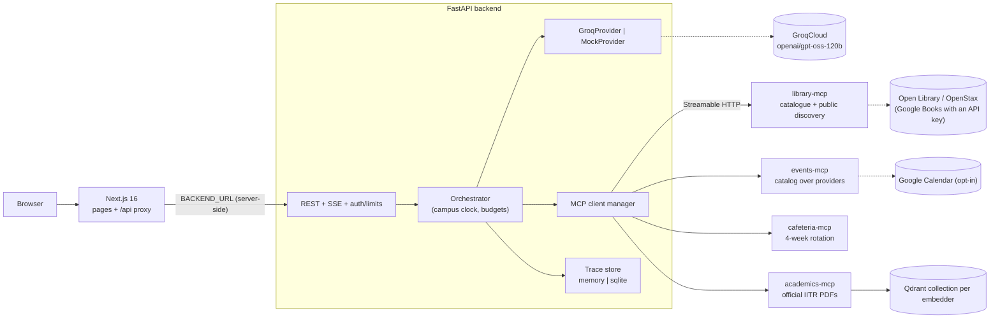
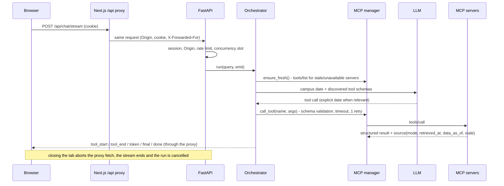

# Architecture

## Components

| Component | Code | Responsibility |
|---|---|---|
| Frontend | `frontend/src` | Client components. `app/api/[...path]/route.ts` proxies `/api/*` to the backend (first-party session cookie, streaming pass-through). `lib/chat-state.ts` is a pure reducer from SSE events to UI state |
| API | `backend/app/api` | Validation, stable errors, SSE, auth endpoints, Origin checks, rate limits, disconnect cancellation, evaluation-run endpoints |
| Security | `backend/app/security.py` | Signed sessions, password check, Origin/Fetch-Metadata checks, trusted-proxy client IP, token-bucket limiter, counters |
| Orchestrator | `backend/app/agent/orchestrator.py` | The tool-calling loop, budgets, run cache, partial results, timings, trace recording; campus clock is the source of truth for "today" |
| Prompts | `backend/app/agent/prompts.py` | System policy (campus date, explicit dates, failure vs empty, demo labelling, campus vs public books), untrusted wrapping, prompt version hash |
| Citations | `backend/app/agent/citations.py` | Citations and source refs from tool output (incl. `retrieved_at`, `staleness_reason`, https-only `source_url`); verifies page references in the answer |
| Traces | `backend/app/agent/trace_store.py` | Memory or SQLite backend, retention, capacity, privacy (redaction, query/payload omission) |
| LLM providers | `backend/app/llm` | `GroqProvider`, `MockProvider` (keyword router + generic discovered-tool fallback), `ScriptedProvider` |
| MCP client manager | `backend/app/mcp/manager.py` | Discovery, registry, schema compaction, argument validation, routing, timeouts, retries, failure classification (incl. `malformed_response`) |
| Fault injection | `backend/app/mcp/faults.py` | `down` / `timeout` / `slow` / `flaky` / `malformed` per server |
| MCP servers | `services/*_mcp` | Own their integrations behind provider interfaces; each has a `campus_time.py` copy |

## Request lifecycle

## Campus time

`CampusClock` (identical `campus_time.py` in the backend and every service) converts an injectable UTC
clock to `CAMPUS_TIMEZONE`. Services compute "today" per request; tests and evaluations inject fixed
instants (18:29Z/18:30Z boundary tests across all three services and the prompt).

## Events catalog

Providers only fetch events for a time window and describe that request's provenance. `EventCatalog`
applies campus-day overlap (multi-day and past-midnight events appear on every day they touch), status
filtering (cancelled hidden unless asked; completed never upcoming), `timing` (past/ongoing/upcoming),
and explicit "queried successfully, nothing matched" notes. Provider failures propagate as tool errors.

## Retrieval

PyMuPDF page text -> chunks that never cross a page (`chunk_official` for official documents: sections
from margin headings + ordinance numbers or `Subject:` lines; calendars as row packs) -> embeddings ->
Qdrant (`<collection>__<embedder>`). Search: dense, or hybrid (dense + BM25 fused with RRF, component
scores kept for the relevance gate) -> relevance gate (threshold per embedder + shared-term guard) ->
injection redaction -> supersession ordering and applicability notes.

## Tool states

`success`, `tool_error`, `invalid_arguments`, `unknown_tool`, `timeout` and `unavailable` (transient;
retried once, then the server is marked unavailable and re-checked), `protocol_error`,
`malformed_response` (a tool that declares structured output returned none), `budget_exceeded`. A run is
`partial` when any executed call ended in timeout/unavailable/protocol_error/malformed_response; other
results are kept and the UI names the failed service.

## Design decisions

- **Short-lived MCP sessions** with stateless servers: one extra round trip per call, no session repair after restarts.
- **Namespaced tool names** (`library__search_books`) and **schema compaction** for Groq's limits.
- **Sequential by default** (GPT-OSS on Groq emits one call per turn); per-turn concurrency is available.
- **Citations from data, not text**; page references in the answer are checked against retrieved passages.
- **Provenance in every result**; the UI never infers "live", and distinguishes out-of-date from unverifiable.
- **Extensibility is tested, not claimed**: `tests/test_extensibility.py` adds a Transport server by configuration.
