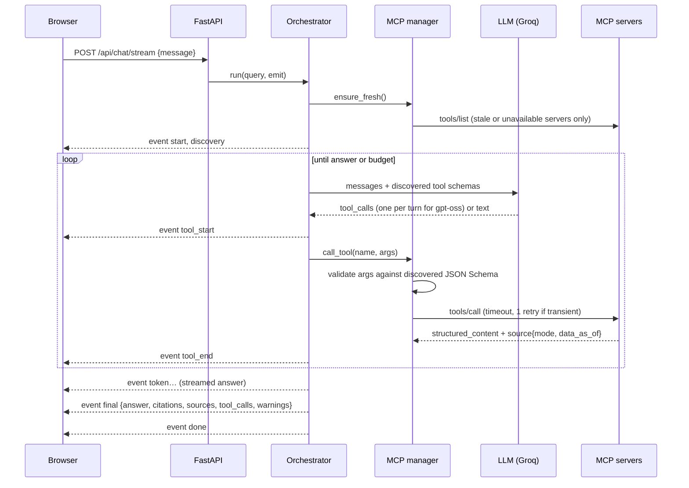

# Architecture

## Components

| Component | Code | Responsibility |
|---|---|---|
| Frontend | `frontend/src` | Client components that call the REST/SSE API. `lib/chat-state.ts` is a pure reducer from SSE events to UI state |
| API | `backend/app/api` | Validation, stable error format, SSE framing, concurrency/size limits, fault-injection gate |
| Orchestrator | `backend/app/agent/orchestrator.py` | The tool-calling loop, budgets, run cache, partial results, trace recording |
| Prompts | `backend/app/agent/prompts.py` | System policy and `<tool_result untrusted="true">` wrapping with size-aware truncation |
| Citations | `backend/app/agent/citations.py` | Builds citations and source refs from tool output; verifies page references in the answer |
| LLM providers | `backend/app/llm` | `LLMProvider` protocol, `GroqProvider` (OpenAI-compatible client), `MockProvider`, `ScriptedProvider` |
| MCP client manager | `backend/app/mcp/manager.py` | Discovery, registry, schema compaction, argument validation, routing, timeouts, retries, failure classification |
| Server config | `backend/app/mcp/config.py`, `backend/config/mcp_servers.json` | Allowlisted servers; env overrides |
| Fault injection | `backend/app/mcp/faults.py` | `down` / `timeout` / `slow` / `flaky` per server, for tests, evals and the demo |
| MCP servers | `services/*_mcp` | Own their data integrations behind provider interfaces |

## Request lifecycle

## Tool states

`success`, `tool_error` (the server ran and reported e.g. not-found; not retried), `invalid_arguments` (rejected before reaching the server), `unknown_tool`, `timeout` and `unavailable` (transient; retried once, then the server is marked unavailable and re-checked after `UNAVAILABLE_RECHECK_S`), `protocol_error`, `budget_exceeded`. A run is `partial` when any executed call ended in timeout/unavailable/protocol_error; the other results are kept.

## Design decisions

- **Short-lived MCP sessions.** The servers are stateless (`stateless_http=True, json_response=True`), so each call opens a session. That adds about 50–70 ms per call locally (the measured HTTP tool-call median is 76 ms vs 14 ms in-process), but there's no session state to lose when a server restarts. A pooled-session manager is a straightforward optimisation behind the same interface.
- **Namespaced tool names** (`library__search_books`) avoid collisions between servers and satisfy Groq's function-name rules.
- **Schema compaction** removes `title` keys before sending schemas to the model, which matters on Groq's 8K TPM free tier.
- **Sequential by default.** GPT-OSS on Groq does not emit parallel tool calls; concurrency is available per turn when a provider does.
- **Citations from data, not text.** The UI shows the passages the tool returned. The model's prose is checked against them, never trusted on its own.
- **Data provenance in every result.** Providers set `source.mode`; the UI never infers "live".
